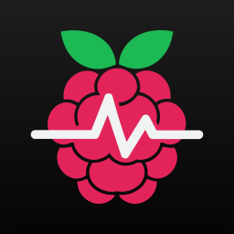

# Pi5 Monitor

Real-time monitor for a Raspberry Pi 5, running on a jailbroken iPad mini 1 (iOS 9.3.6, armv7)
as a home-screen web clip. Sibling project of Spotipad, same delivery model: a tiny native
daemon on the iPad plus a single-page UI in Safari.

Design goals:

- **Nothing in the background.** The iPad daemon is started by launchd only when the page
  connects and exits after 40 s of silence. The Pi gets no service, no agent and no open
  connection: every refresh is one short SSH session that prints `/proc` and `/sys` and exits.
- **Refresh by default.** Polling (1 s, 5 s, 30 s or 60 s) is opt-in and resets to Off whenever the app is
  left or reopened. Nothing is fetched while the page is hidden.
- **Cheap on both ends.** About 10 ms of collector CPU on the Pi, ~240 ms per refresh on the A5,
  ~1.6 KB JSON to the page, daemon RSS under 1 MB.

## What it shows

CPU (total, per core, clock, load), CPU and RP1 temperature, fan, throttling and
under-voltage flags (`vcgencmd get_throttled`), memory, cache and zram swap, network rate per
interface, a storage donut like Dokploy's (Docker images, containers, volumes, build cache,
system cache, system, free; the Docker part is measured on demand and cached), disk I/O rate, uptime, process and thread counts, Docker containers (CPU %
of one core and anonymous memory, read straight from cgroup v2, no Docker API) and the top 10
processes by CPU. Sparklines keep the samples of the current session only.

## How it works

```
Safari web clip  http://127.0.0.1:8899/
   |  XHR on Refresh, or while polling and visible
pi5mon (C, armv7)          launchd socket job, exits when idle
   |  /usr/bin/ssh, one session per refresh
Pi: dropbear -> forced command /usr/local/lib/pi5monitor/collect.sh
```

The iPad's SSH key is locked on the Pi with `command="...collect.sh",no-pty,no-port-forwarding,
no-agent-forwarding,no-X11-forwarding`, so it can only read metrics. LAN discovery opens TCP 22
on every host of the iPad's /24 for 1.5 s, reads the SSH banner and flags Raspberry Pi MAC
prefixes from the ARP table.

See [docs/ARCHITECTURE.md](docs/ARCHITECTURE.md) and [docs/BUILD-DEPLOY.md](docs/BUILD-DEPLOY.md).

## Install

Requirements: macOS host with Command Line Tools (MacOSX15 SDK), `expect`; jailbroken iPad with
OpenSSH and `ldid`; a Pi running Linux with cgroup v2 and an SSH server that honours
`command=` in `authorized_keys` (dropbear or OpenSSH).

```sh
export IPAD_HOST=<ipad-ip>            # e.g. 192.168.1.20
export IPAD_JUMP=root@<jump-host>     # optional: only if the Mac is not on the iPad's LAN
scripts/install.sh                    # build, push, launchd job, web clip, iPad SSH key, respring
scripts/install-pi.sh root@<pi>       # collector + the iPad key (read from the iPad), locked to it
```

Update the daemon or the page later with `scripts/deploy.sh`.

## Troubleshooting

- **"Permission denied (publickey)"**: the iPad key is not in the Pi's `authorized_keys`; rerun
  `scripts/install-pi.sh`.
- **"daemon not reachable"**: `launchctl list | grep pi5monitor` on the iPad; reload with
  `launchctl unload/load /Library/LaunchDaemons/dev.pi5monitor.daemon.plist`. After an iPad
  reboot the jailbreak must be re-applied first.
- **Pi reinstalled (new host key)**: delete `/var/root/pi5monitor/known_hosts` on the iPad.
- **Container shows a hex id**: names are cached in `/var/root/pi5monitor/names-<ip>.txt`
  and fetched once when a new container appears; delete the file to refetch all.
- **Scan misses the Pi**: use the Manual field with its IP.
